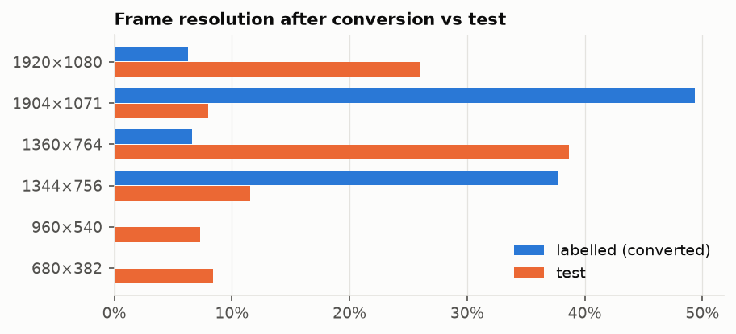
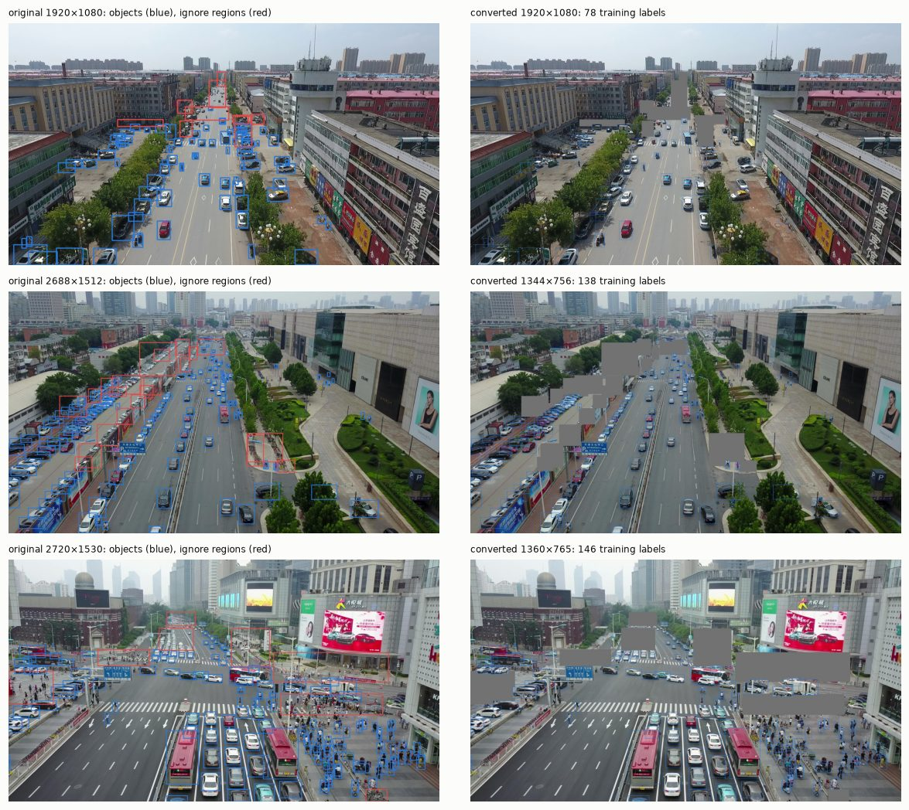
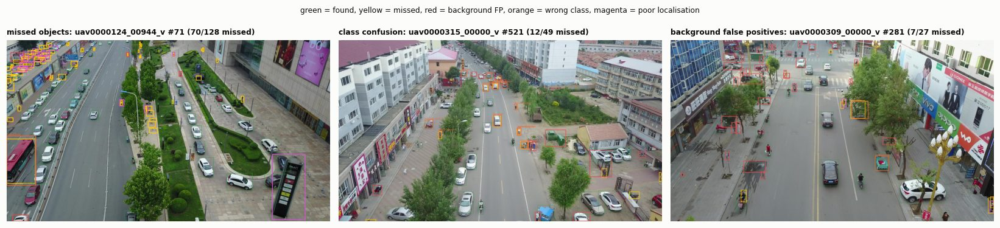
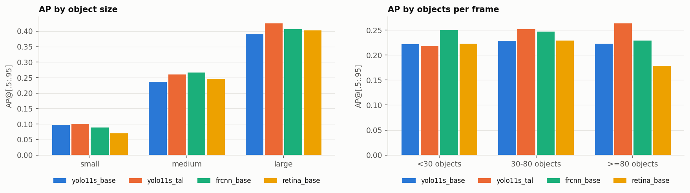
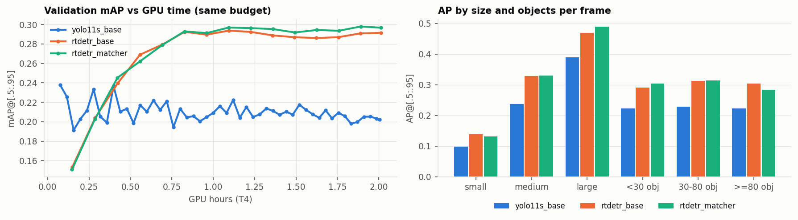
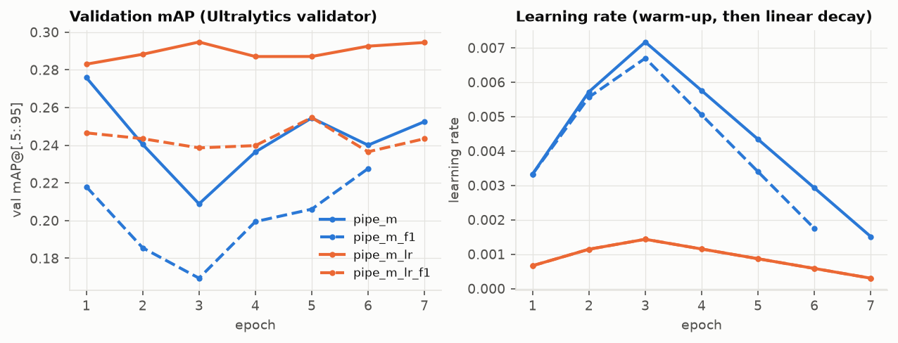

## 1. Task and data

Detect 8 classes in 48 unlabelled drone clips (3,811 frames). There are 63 labelled clips (27,047
frames, 1.22 M boxes). Code: `src/visdet/`, one notebook per section (`notebooks/01`–`07`), settings in
`configs/`, and every evaluated run in `experiments/results.csv` (metrics, history and config per run in
`experiments/runs/<run>/`).

Findings before the design (`01_eda.ipynb`):

| Observation | Decision |
|---|---|
| Test frames are the labelled resolutions halved until less than 1920 px wide; some are quartered (960×540, 680×382) | Convert all labelled frames to test scale |
| 54 % of objects are < 32 px at a 1280-px input (median 31 px, 10 % < 16 px) | Input 1280 for all benchmarks; 16-px anchors; P2 head, tiles |
| Up to 180 objects per frame | 500 detections per image everywhere; up to 500 DETR queries |
| car + person = 75 % of boxes; bus 0.8 % (25 of 63 clips) | per-class AP; folds stratified by density × person share |
| Ignore regions in 72 % of frames | gray fill in training frames, boxes > 50 % inside dropped (1.2 %); `iscrowd` in evaluation |
| The same object 10 frames later has a median IoU of 0.35 | train on every 10th frame (~2.2k frames per fold) |

## 2. Methodology

**Preprocessing** (`visdet.prepare`). The 10 VisDrone classes are merged into 8 (pedestrian + people ->
person, tricycle + awning-tricycle -> tricycle). "Ignored regions" and "others" become class-agnostic
ignore regions. Frames are halved until they fit 1920 px (`INTER_AREA`, like the test set). Ignore
regions are filled with gray, but pixels of kept boxes are never painted over. The conversion is verified
by overlays and by an exact label count.

**Validation.** Frames within a clip are near-duplicates, so all splits are by **clip**: 5 folds via
`StratifiedKFold` over clips (strata: density tercile × person-heavy). All detector comparisons use
fold 0 (13 clips, 603 frames), unmasked and at test scale. Finalists are re-trained on folds 1–2
(out-of-fold, OOF). **Metric:** COCO mAP@[.5:.95] with ignore regions as `iscrowd` for every class,
500 detections per image (`visdet.evaluate`), plus AP50, AP_s/m/l, per-class AP, AP by objects per
frame, and FPS (T4, batch 1, incl. NMS). Perfect boxes score 1.0, shifted boxes score lower, and false
positives inside ignore regions cost nothing (unit-checked).

**Protocol.** Input long side 1280, COCO-pretrained weights, seed 42, 2× T4 with DDP. torchvision models
train for 12 epochs (SGD, step schedule); Ultralytics models get a fixed **2 GPU-hour** budget each. Every
tweak changes one setting of the family's reference config.

## 3. Detector families (fold 0)

| Run | Change | mAP | AP50 | AP_s | AR | FPS |
|---|---|---|---|---|---|---|
| **Faster R-CNN** R50-FPN v2 (`03`) | torchvision defaults, 500 dets | **0.235** | 0.451 | 0.089 | 0.373 | 5.5 |
| | anchors 16–256 (instead of 32–512) | 0.229 | 0.440 | 0.098 | 0.355 | 5.5 |
| | + 4000/2000 RPN proposals | 0.234 | 0.454 | 0.094 | 0.384 | 4.2 |
| | + GIoU RoI box loss | 0.226 | 0.449 | 0.098 | 0.384 | 5.3 |
| **RetinaNet** R50-FPN v2 (`04`) | torchvision defaults, 500 dets | **0.211** | 0.391 | 0.069 | 0.349 | 8.3 |
| | anchors 16–256 × 3 scales | 0.197 | 0.398 | 0.084 | 0.370 | 8.4 |
| | + IoU thresholds 0.4/0.3 | 0.198 | 0.402 | 0.085 | 0.350 | 8.4 |
| | + focal α 0.5, γ 1.5 | 0.201 | 0.409 | 0.090 | 0.368 | 8.4 |
| **YOLO11s** (`05`) | Ultralytics defaults | 0.222 | 0.414 | 0.098 | 0.351 | 63 |
| | input 960 / 1536 | 0.209 / 0.233 | | 0.102 / 0.104 | | 68 / 50 |
| | P2 head (stride 4) | 0.203 | 0.398 | **0.121** | 0.344 | 50 |
| | TAL top-k 10 → 13 | **0.240** | 0.440 | 0.101 | 0.378 | 64 |
| **RT-DETR-L** (`06`) | 300 queries | 0.292 | 0.517 | 0.139 | 0.440 | 13 |
| | 500 queries | 0.287 | 0.513 | 0.142 | **0.463** | 13 |
| | matching cost GIoU 2 → 5 | **0.295** | 0.527 | 0.131 | 0.444 | 13 |
| | backbone LR × 0.1 | 0.290 | 0.509 | 0.143 | 0.445 | 13 |

**Two-stage.** The RPN scores every anchor for objectness and keeps ≤ 1000 proposals. It decides *where* to
look and sets the recall ceiling. The RoI head re-pools each proposal (RoIAlign) and decides *what* it is and
*where exactly* the box goes. Measured on `frcnn_base` (recall at IoU 0.5), the proposals cover 33 % of
objects < 16 px and 71 % of 16–32 px, and the final detections reach 34 % / 68 %. For small objects the
RPN is the bottleneck. For large objects the RPN covers 97 %, but the head keeps only 90 %. Smaller
anchors and more proposals raised AP_s and AR as intended, but the default config stayed best in mAP. More proposals cost 24 % FPS for no mAP. GIoU lowered AP75
(0.206 vs 0.222), so it did not help localisation here. Failure cases of `frcnn_base`:

1. **Tiny, distant objects** (left, 70 of 128 missed): people and vehicles of a few pixels in the far,
   crowded part of the scene. Only 16 % of objects < 16 px are found: they are below what stride-4/8
   features and the 32-px default anchors resolve.
2. **Class confusion** (middle): seen from above, similar shapes merge. 588 of 1,011 vans are predicted
   as car, tricycles as motor (288) or truck (135), and bicycles as motor (135 of 247).
3. **Background false positives** (right): clutter along storefronts (signs, displays, parked two-wheelers)
   is boxed as people or motors. Some are plausibly real but unlabelled objects.

**One-stage anchor-based.** Without proposals the classifier scores 172,980 anchors per frame for a
median of 43 objects (~4,000 negatives per object). Focal loss and positive-assignment thresholds carry
that imbalance, and boxes get no second refinement. As predicted, RetinaNet loses most in dense scenes:
AP 0.18 at ≥ 80 objects vs 0.23 for Faster R-CNN. EDA-grounded anchors and a softer focal loss raised
AP_s (0.069 → 0.090) and AR, but cost large-object AP, so the defaults stay best. RetinaNet is 1.5× faster
than Faster R-CNN but 0.024 mAP worse.

**Anchor-free.** TAL picks the top-k grid points inside each box by score^0.5 · IoU^6, so assignment
adapts to the prediction instead of fixed anchor shapes. A 12-px object covers only 1–4 points at
stride 8, so resolution and stride decide small-object recall. P2 gave the best AP_s of all CNNs (0.121), but
half the batch and fewer epochs in the budget cost mAP. 1536 helped and 960 hurt. TAL top-k 13 (more
positives per dense cluster) was best, with AP 0.263 at ≥ 80 objects vs 0.229 for Faster R-CNN. *Caveat
found later (§4):* in most YOLO runs the best checkpoint was from epoch 1–2, so these comparisons largely
measure early fine-tuning.

**Query-based.** Each object is matched to exactly one query (Hungarian matching on class + L1 + GIoU
cost), so duplicates are penalised in training and no NMS is needed. The price is slow early training:
0.15 mAP after the first epoch, against 0.24 for YOLO. RT-DETR **converged within the budget**: it rises
until ~0.8 GPU-h, then plateaus at 0.29. It is the best family on small objects (AP_s 0.13–0.14) and dense
scenes (0.28–0.31 at ≥ 80 objects). 500 queries raised AR and dense-scene AP but not mAP. The GIoU-weighted
matching cost gave the best mAP.

| Tuned detector | mAP | AP50 | AP_s | AP_m | AP_l | FPS |
|---|---|---|---|---|---|---|
| Faster R-CNN (`frcnn_base`) | 0.235 | 0.451 | 0.089 | 0.266 | 0.406 | 5.5 |
| RetinaNet (`retina_base`) | 0.211 | 0.391 | 0.069 | 0.246 | 0.402 | 8.3 |
| YOLO11s (`yolo11s_tal`), public LB 0.205 | 0.240 | 0.440 | 0.101 | 0.261 | 0.425 | 64 |
| RT-DETR-L (`rtdetr_matcher`) | **0.295** | **0.527** | **0.131** | **0.330** | **0.489** | 13 |

## 4. Final pipeline (`07`)

Starting point: `yolo11s_tal`, the best anchor-free model (RT-DETR enters in part B). One change at a time on
fold 0; ΔmAP is against `yolo11s_tal` in part A and against `pipe_tiles` (the best data setting) in part B:

| Part | Run | Change | mAP | ΔmAP |
|---|---|---|---|---|
| A · inference | `+tta` / `+tta_ms` | flip TTA / flip + 1.25× scale | 0.246 / **0.263** | +0.007 / +0.023 |
| | `+tiles` | 2×2 tiles (20 % overlap) + full frame, NMS | 0.258 | +0.018 |
| A · data | `pipe_step5` | every 5th frame | 0.250 | +0.010 |
| | `pipe_nomask` | ignore regions not grayed out | 0.228 | −0.012 |
| | `pipe_degrade` | random ×0.5–0.8 down/up-scaling | 0.229 | −0.011 |
| | `pipe_tiles` | train and predict on tiles | **0.266** | **+0.027** |
| B · model (on tiles) | `pipe_m` | YOLO11m | 0.277 | +0.011 |
| | `pipe_long` | 2× budget | 0.266 | 0.000 |
| | `pipe_ens` | `pipe_m` + `rtdetr_matcher`, weighted boxes fusion | **0.306** | +0.040 |
| | `pipe_m_lr` | YOLO11m, `lr0` 0.01 → 0.002 | 0.292 | +0.026 |

Tiles help most because objects become 1.8× larger at the same input size. Gray-filling ignore regions
helps: without it, unlabelled crowds are taught as background. Down-scaling augmentation hurt small
objects (AP_s 0.087).

**The learning rate.** `pipe_long` gave exactly the same metrics as `pipe_tiles` because both kept their
**epoch-1** checkpoint. In 11 of 15 YOLO runs with `lr0` 0.01 the best checkpoint is from epoch 1–2:
validation mAP falls while the warm-up raises SGD's learning rate to 0.007–0.009 and barely recovers.
RT-DETR (AdamW, 1e-4) kept improving. With `lr0` 0.002 the same model peaks at epochs 3–7 instead, and
gains +0.026 OOF:

**Out-of-fold check** (mAP; stage C picked `pipe_m`/`pipe_tiles`, stage E added the rest):

| Spec | fold 0 | fold 1 | fold 2 | mean ± std |
|---|---|---|---|---|
| `pipe_ens` (YOLO11m + RT-DETR) | 0.306 | 0.261 | 0.272 | **0.280 ± 0.023** |
| `rtdetr_matcher` | 0.295 | 0.257 | 0.265 | 0.272 ± 0.020 |
| `pipe_m_lr` | 0.292 | 0.247 | 0.251 | 0.263 ± 0.025 |
| `pipe_m` | 0.277 | 0.214 | 0.221 | 0.237 ± 0.034 |
| `pipe_tiles` | 0.266 | 0.207 | 0.212 | 0.229 ± 0.033 |

The rankings agree on all three folds. Fold 0 is the easiest (+0.04–0.06).

**Submissions** (models for "all clips" are re-trained on all 63 clips for 1.5× the budget):

| Submission | Trained on | OOF mAP | public LB |
|---|---|---|---|
| `yolo11s_tal` (notebook 05) | fold 0 | — | 0.205 |
| `pipe_m` | all clips | 0.237 | 0.229 |
| `pipe_tiles` | all clips | 0.229 | 0.231 |
| `pipe_ens` | fold 0 | 0.280 | 0.266 |
| `pipe_m` + RT-DETR | all clips | 0.280 | 0.324 |
| **`pipe_m_lr` + RT-DETR** | all clips | — | **0.351** |

The public LB follows the OOF mean (0.229–0.231 for OOF 0.229–0.237), so the validation is reliable.
Training on all clips adds ~0.06 (0.266 → 0.324 for the same ensemble).

**Unsuccessful attempts.** EDA-grounded anchors (both anchor-based families), GIoU in the RoI head, more
RPN proposals, the P2 head under a fixed budget, 500 DETR queries, a 2× schedule, no gray fill, and
down-scaling augmentation. The first finalists (`pipe_m`, `pipe_tiles`) were chosen before the
learning-rate problem was found, so they reached only 0.23 on the LB.

## 5. Final model and how to reproduce

**Selected:** (1) **`pipe_m_lr` + `rtdetr_matcher`**, both trained on all 63 clips: YOLO11m on 2×2 tiles,
`lr0` 0.002, TAL top-k 13, input 1280; RT-DETR-L with GIoU-weighted matching. They are fused with weighted
boxes fusion (IoU 0.6, equal weights, ≤ 500 boxes per image). Each member improved its own OOF mAP over
the members of the validated ensemble. (2) `pipe_m` + `rtdetr_matcher`, the ensemble with the best
measured OOF mAP (0.280).

1. `pip install -e . -r requirements.txt` (pinned `ultralytics==8.4.191`, `pycocotools==2.0.11`,
   `ensemble-boxes`; Kaggle's torch 2.x). Kaggle, *GPU T4 ×2*, internet on.
2. `notebooks/02_prepare_data.ipynb` (CPU): writes `prepared/` and `prepared_nomask/`.
3. `notebooks/05` and `06`: produce `yolo11s_tal` and `rtdetr_matcher` (inputs: competition data, 02).
4. `notebooks/07_pipeline.ipynb` (inputs: competition data, 02, 05, 06). Stages A–E need ~25 h of wall
   time, so the notebook spans 2–3 sessions. A run that would not fit in the session is not started. Attach the
   notebook's own latest output and run again: finished runs are carried over. Stage E writes
   `submission_ens_lr_all.csv` (selected 1) and `submission_ens_all.csv` (selected 2).
5. Seeds: 42 everywhere (folds, samplers, Ultralytics). Each run's full config is in
   `experiments/runs/<run>/config.yaml`. Logged training used ~76 T4 GPU-hours in total.
